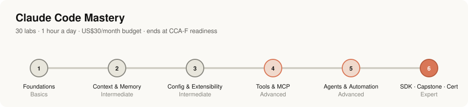

# Claude Code Mastery: from first prompt to certified architect in 6 weeks

### A hands-on course for software engineers: 1 hour a day, 5 days a week, 6 weeks



Welcome! I'm really glad you're here.

Over the next six weeks you'll go from typing your first prompt into Claude Code
to designing, configuring, extending and automating agentic coding workflows the
way expert teams do. You will also be ready to sit the
**Claude Certified Architect – Foundations (CCA-F)** exam.

Every day is one focused hour in a GitHub Codespace. You won't need to install
anything on your laptop, and you can't break anything that matters. You'll work on
**TaskForge**, a small but realistic Python API with real bugs, missing features
and a legacy module waiting to be tamed. By the end you'll have fixed it, extended
it, wrapped it in an MCP server, automated it in CI, and built an agent on top of
it with the Claude Agent SDK.

> **The one rule of this course:** you learn Claude Code by *using* Claude Code.
> Read the lab, then let Claude do the typing while **you** do the thinking:
> scope the task, review the diff, and decide.

---

## The six weeks

| Week | Theme | Level | You will be able to... | Budget |
|---|---|---|---|---|
| [1](1_foundations) | **Foundations** | Basics | drive a session, choose permission modes, fix bugs test-first, write precise prompts, manage context and cost | $3 |
| [2](2_context_and_memory) | **Context & Memory** | Intermediate | write a lean CLAUDE.md and rules, use plan mode for multi-file work, run a Git/PR workflow, do TDD with Claude | $4 |
| [3](3_configuration_and_extensibility) | **Configuration & Extensibility** | Intermediate | lock down permissions, write skills, slash commands and hooks, customise output, package a team plugin | $5 |
| [4](4_tools_and_mcp) | **Tools & MCP** | Advanced | connect MCP servers, build your own with well-designed tools, get schema-validated structured output | $6 |
| [5](5_agents_and_automation) | **Agents & Automation** | Advanced | delegate to subagents, work in parallel with worktrees, script headless runs, put Claude in CI, finish long tasks reliably | $7 |
| [6](6_agent_sdk_capstone_certification) | **Agent SDK, Capstone & Certification** | Expert | build agents with the Claude Agent SDK, review agentic architectures, ship a capstone, pass a mock CCA-F exam | $6 |

Each week has five labs (`1_lab1_...md` to `5_lab5_...md`). Most weeks end with a mini-project and a short
**offline** quiz in [assessments/](assessments).

## How a day works (60 minutes)

| Minutes | What you do |
|---|---|
| 0–5 | **Read** the lab's goal and short primer |
| 5–45 | **Do** the numbered steps in Claude Code. Each one gives you the exact prompt to type |
| 45–55 | **Verify** with `uv run labcheck wNdM` (free: it never calls the API) and answer the reflection questions |
| 55–60 | **Log** what the lab cost: `uv run labcheck log wNdM 0.42 "note"` |

If you finish early, every lab has a **🚀 Stretch** exercise. If you fall behind,
[checkpoints/](checkpoints) lets you jump to the start of any week.

## Getting started

1. Follow **[setup/SETUP-codespaces.md](setup/SETUP-codespaces.md)**. It takes about 10 minutes, and your admin gives you an API key.
2. Open **[1_foundations/1_lab1_first_session.md](1_foundations/1_lab1_first_session.md)** and begin.

Always start Claude Code from the **repo root** (`claude`). The course's settings,
status line and labcheck all assume you do.

## API costs: please read me!

Each engineer gets an Anthropic API key with a **US$30/month** spending limit.
That is plenty for this course **if** you use Claude Code the way professionals do.
For comparison, Anthropic reports that a typical professional developer spends about
$13 on a *single* active day. The course is designed so a whole day costs
you roughly $0.60–$1.40.

| What protects your budget | How |
|---|---|
| **Your admin's hard limit** | Your key belongs to a workspace capped at $30/month. Hitting it stops requests; it never bills more. |
| **The status line** | It shows `session $` and `month ~$` at the bottom of every Claude Code session: green, then yellow at 70%, then red at 90%. |
| **Budget caps per lab** | Every lab states its cap. If you're over, stop and check what's eating tokens (`/context`). |
| **Sonnet by default** | `.claude/settings.json` sets `"model": "sonnet"`. Opus is for when you choose it deliberately. |
| **Small codebase** | TaskForge is about 600 lines, so contexts stay small. |
| **Free checks and quizzes** | `labcheck`, the quizzes and the mock exam spend nothing. |
| **No peeking, no noise** | Course settings stop Claude reading `solutions/`, `checkpoints/` and the hidden tests. That keeps the labs honest and keeps duplicate files out of its searches. |

Habits you'll build from Day 1 are `/clear` between tasks, `@file` mentions instead of
"look at everything", `/compact` with a focus, cheap models for subagents, and
`--max-budget-usd` on every scripted run. These are exactly the habits that make Claude
Code affordable at company scale.

See [guides/04_cost_management.md](guides/04_cost_management.md) for the details.

## Repo layout

```
setup/            Codespaces setup, troubleshooting, admin guide for API keys
guides/           short primers (terminal, git, tokens, cost, prompting, reviewing AI code, the CCA-F exam)
practice-app/     TaskForge: the codebase you work on (see practice-app/ISSUES.md for the backlog)
1_foundations/ … 6_agent_sdk_capstone_certification/   the 30 daily labs
assessments/      weekly quizzes, the 60-question mock exam, capstone rubric
solutions/        reference solutions (try first, then compare)
checkpoints/      practice-app snapshots at the start of each week
labcheck/         the free checker behind `uv run labcheck`
community_contributions/   share your skills, hooks, agents and capstones
```

## Certification

The course maps to the five domains of the **Claude Certified Architect – Foundations**
exam. See [guides/07_cca_f_exam_overview.md](guides/07_cca_f_exam_overview.md) for which labs
cover which domain and how to register. Week 6 ends with a full-length,
timed mock exam.

## Getting help

- **Stuck on a lab?** First ask Claude! Try: *"I'm doing lab w2d8 and labcheck says X. Help me understand why without giving me the full solution."* Then check `solutions/`.
- **Setup problems:** see [setup/troubleshooting.md](setup/troubleshooting.md).
- **Something wrong in the course?** Open an issue on this repo.
- **Built something cool?** Add it to `community_contributions/` and open a PR.

## Keep in mind

Claude Code moves fast. Every command in this course was checked against the official
docs ([code.claude.com/docs](https://code.claude.com/docs)) when it was written. If something
has changed, the docs win, and a PR to fix the lab is very welcome.

**Above all else: have fun with it.** You're learning to work alongside a genuinely
capable collaborator, and that's a pretty great way to spend an hour a day.
